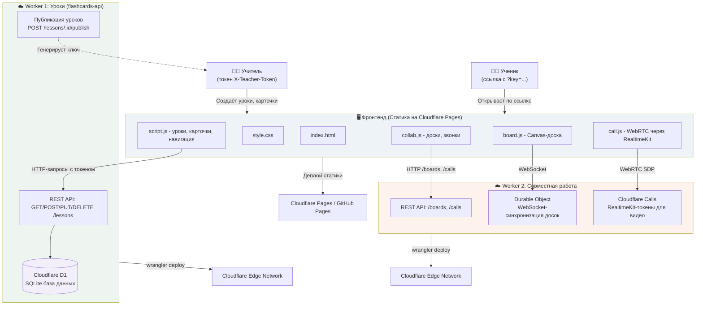

# Архитектура приложения English Flashcards

---

## Поток данных

### 1. Создание и редактирование уроков (учитель)
1. Учитель открывает фронтенд и выбирает роль «Я учитель»
2. При первом запросе браузер запрашивает токен учителя
3. `script.js` отправляет `POST /lessons` с заголовком `X-Teacher-Token: abc123`
4. **Worker 1** проверяет токен против `TEACHER_TOKEN` из секретов
5. Если валиден — сохраняет урок в **D1** и возвращает `{ id, title, cards }`
6. Фронтенд обновляет UI и отображает новый урок

### 2. Публикация урока и доступ ученика
1. Учитель нажимает «Опубликовать урок» → `POST /lessons/:id/publish`
2. Worker генерирует случайный ключ `publish_key` и записывает `published = 1` в D1
3. Фронтенд показывает ссылку-приглашение: `https://site.com/?lesson=uuid&key=abc123`
4. Ученик открывает ссылку → `script.js` отправляет `GET /lessons/:id?key=abc123`
5. Worker проверяет, что `published = 1` и ключ совпадает → возвращает урок без токена
6. Фронтенд показывает карточки и скрипт ученика (без кнопок редактирования)

### 3. Интерактивная доска (реал-тайм синхронизация)
1. Учитель создаёт доску → `POST /boards` с токеном
2. **Worker 2** генерирует ключ и возвращает ссылку `?board=uuid&key=def456`
3. Учитель открывает доску → `board.js` устанавливает WebSocket на `ws://worker2/boards/:id/ws`
4. Worker маршрутизирует соединение к **Durable Object** с ID = `board-uuid`
5. При рисовании линии `board.js` отправляет `{ type: 'update', state: { objects: [...] } }`
6. Durable Object сохраняет состояние и рассылает всем подключённым клиентам
7. Ученик открывает ту же ссылку → WebSocket получает актуальное состояние и рендерит холст

### 4. Видеозвонок (Cloudflare Calls + RealtimeKit)
1. Учитель нажимает «Видеозвонок» → `POST /calls` с токеном
2. Worker генерирует `roomId` и ключ приглашения
3. Учитель вводит имя → `POST /calls/:roomId/token` (с токеном)
4. Worker создаёт **LiveKit Access Token** с preset `host` (все разрешения)
5. `call.js` подключается к Cloudflare Calls через RealtimeKit SDK
6. Ученик открывает ссылку `?call=roomId&key=xyz` → запрашивает токен с preset `student`
7. Worker проверяет ключ → выдаёт токен с ограниченными правами (только subscribe + publish аудио/видео)
8. RealtimeKit устанавливает P2P-соединение (WebRTC) напрямую между участниками

---

## Безопасность

### Аутентификация учителя
- Токен учителя **не хранится в localStorage** фронтенда (только в sessionStorage текущей вкладки)
- Worker проверяет `X-Teacher-Token` в каждом запросе, требующем прав учителя
- Токен задаётся через `wrangler secret put TEACHER_TOKEN` и хранится зашифрованным на Cloudflare

### Доступ ученика
- Ученик получает ссылки с одноразовыми ключами, сгенерированными сервером
- Ключ урока проверяется против `publish_key` в D1
- Ключ доски/звонка проверяется в Worker перед выдачей токена или открытием WebSocket
- Без правильного ключа запрос возвращает `403 Forbidden`

### Изоляция данных
- Каждая доска — отдельный Durable Object, изолированный от других досок
- Уроки и карточки учителя не видны другим учителям (если не опубликованы)
- В бесплатном D1 нет шифрования at-rest, но данные не являются персональными (только образовательный контент)

---

## Масштабирование

### Cloudflare Edge Network
- Worker'ы развёрнуты на всех датацентрах Cloudflare (300+ городов)
- Запросы обрабатываются ближайшим к пользователю сервером (латентность < 50 мс)
- При высокой нагрузке Cloudflare автоматически распределяет запросы по изоляции-инстансам

### Durable Objects (доски)
- Каждая доска — отдельный объект с гарантированной консистентностью
- При росте количества участников (> 10) WebSocket-соединения могут замедлиться — рекомендуется ограничить до 5 участников на доску
- Если нужно больше — переключитесь на Yjs + CRDT вместо централизованного broadcast

### D1 (база данных уроков)
- Бесплатный tier: 5 млн операций чтения/день → достаточно для 500 учеников × 10 уроков каждый
- При превышении лимита → переход на оплату ($0.001 за 1000 операций)
- Альтернатива: переход на Cloudflare KV (key-value хранилище) для кэша часто читаемых уроков

### Cloudflare Calls (видео)
- Бесплатно: 1000 минут/месяц (beta)
- Один звонок учитель+ученик 30 минут = 60 минут (2 участника)
- При превышении лимита — звонки будут отклонены с ошибкой
- Решение: переход на платный план Cloudflare Calls или интеграция стороннего сервиса (Agora, Twilio Video)

---

## Альтернативы и варианты деплоя

### Фронтенд
| Сервис | Преимущества | Недостатки |
|--------|--------------|------------|
| **Cloudflare Pages** | Бесплатный SSL, CDN, git-интеграция | Требует аккаунт Cloudflare |
| **GitHub Pages** | Простейший деплой, бесплатный | Нет поддержки SPA-роутинга (без настройки) |
| **Vercel** | Автоматический preview для PR | Лимит 100 GB bandwidth/месяц |
| **Netlify** | Drag-and-drop деплой, бесплатный SSL | Лимит 100 GB bandwidth/месяц |

### Backend (замена Cloudflare Workers)
| Решение | Преимущества | Недостатки |
|---------|--------------|------------|
| **Cloudflare Workers + D1** (текущее) | Serverless, edge-сеть, бесплатный tier | Нет ORM, SQL-миграции вручную |
| **Supabase** | PostgreSQL, REST API из коробки, аутентификация | Требует регистрацию, медленнее Worker |
| **Firebase Firestore** | NoSQL, реал-тайм подписки, бесплатный tier | Запросы ограничены, нет SQL |
| **Railway + Node.js** | Полный контроль, любые библиотеки | Платный (от $5/месяц), не edge-сеть |

### Доски (замена Durable Objects)
| Решение | Преимущества | Недостатки |
|---------|--------------|------------|
| **Durable Objects** (текущее) | Консистентность, WebSocket из коробки | Лимит 1 млн запросов/месяц |
| **Yjs + WebRTC** | P2P-синхронизация без сервера | Сложная настройка, нужен signaling-сервер |
| **Firebase Realtime Database** | Готовая реал-тайм БД | Платные операции записи, медленнее WS |
| **Socket.IO + Redis** | Проверенное решение | Требует выделенный сервер |

### Видеозвонки (замена Cloudflare Calls)
| Решение | Преимущества | Недостатки |
|---------|--------------|------------|
| **Cloudflare Calls** (текущее) | Бета бесплатно 1000 мин/месяц, edge-сеть | Бета-версия, может измениться |
| **Agora.io** | Бесплатно 10,000 минут/месяц, SDK на всех платформах | Требует регистрацию, медленнее edge |
| **Daily.co** | Бесплатно до 10 комнат × 5 участников | Только через iframe, нет WebRTC SDK |
| **Twilio Video** | Высокое качество, мощный API | Дорого ($0.0015/мин/участник) |
| **Jitsi Meet** | Полностью open-source, self-hosted | Требует сервер (от $10/месяц VPS) |

---

## Будущие улучшения

### Планируется в следующих версиях
- [ ] Аудиозаписи к карточкам (произношение английских фраз)
- [ ] Экспорт урока в PDF/PPTX для печати
- [ ] Мультиплеер на доске (> 2 участников) с аватарами курсоров
- [ ] Запись видеозвонка (сохранение на Cloudflare R2 или S3)
- [ ] Чат внутри звонка (WebSocket-сообщения через Worker)
- [ ] Темы оформления карточек (минимализм, газетный стиль, детский)
- [ ] Поддержка других языков (немецкий, испанский, французский)

### Вклад в проект
Хотите добавить новую фичу? Откройте issue или pull request в репозитории!

---

**Автор**: Dasha  
**Лицензия**: MIT  
**Версия**: 2.0.0 (Облачная версия с совместной работой)
